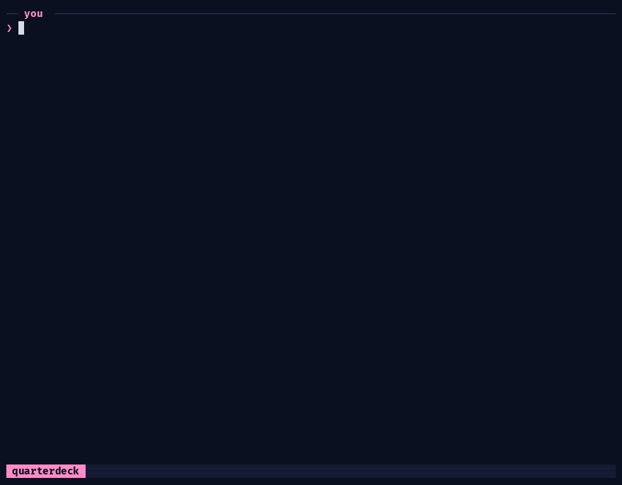
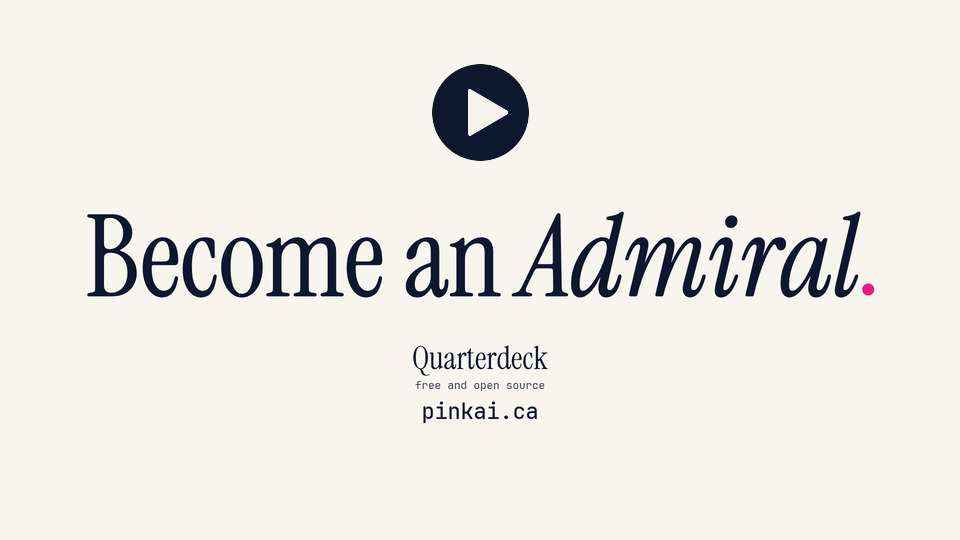

# Quarterdeck

**One crew, every provider.**

Quarterdeck runs AI coding agents from different companies as one crew, on your machine and under your command. You direct it by talking to its agents in plain words, or by typing its commands yourself. The agents hand each other orders, report back, and rotate providers when a quota is spent, among those you have named for each agent.

**Supported harnesses:** Claude Code (Anthropic) · Codex (OpenAI) · Grok Build (xAI) · Antigravity (Google) · OpenCode and pi (OpenRouter, local models, other endpoints). Muse (Meta) is being added.

<p align="center">
  
</p>

<p align="center"><sub>One order, typed once, crossing three programs and back in 38 seconds. Real programs, real models, real speed, with three idle pauses shortened. <a href="docs/DEMO.md">How this was recorded</a>.<br>Three more recordings, each begun with one sentence typed at the desk of an office, are on <a href="https://pinkai.ca/#run">the product page</a>.</sub></p>

<p align="center">
  <a href="https://pinkai.ca/media/quarterdeck/"></a>
</p>

<p align="center"><sub>A ship for the age of agents · 3:31 · <a href="https://pinkai.ca/dashboard/">Live dashboard</a></sub></p>

Every agent runs in its normal terminal interface, the one made for people, in a tmux pane. A ship is a crew of such agents, its panes grouped into tmux sessions. Setup puts your desk in a separate office whose session is titled `Office` by default. The captain and engineer share the project ship's `bridge` session, titled from the declared ship name, as in `Endeavour Bridge`. The tracked default ship keeps all three in one ship, with the desk in `Office` and the captain and engineer in `default Bridge`. Each ship's sessions are on a tmux server of its own, apart from any tmux you use yourself, and `qd attach` opens them. At any time you can attach, watch an agent work, scroll back through what it did, give it a command, or simply prompt it yourself. Inside, tmux's own keys apply: by default, `Ctrl-b n` moves to the next agent of the session, and `Ctrl-b d` detaches, leaving every agent running.

Quarterdeck is a command, `qd`, and one small service for each ship, on your machine. It starts the agents, types orders and reports into their panes as you would, watches them, and accounts for what they spend. In `Office`, the session you work in, the desk watches for its messages itself, so that your own typing there is not disturbed. Quarterdeck adds no plug-ins, tools, hooks or protocols to your harnesses, beyond a status line command in each Claude Code agent's own settings, and runs no agent as a hidden background process. Restart any agent of the crew at any moment: once its turn has ended, it comes back with its brief and a list of its open messages, the ones it still has to answer and the ones it sent that still wait for an answer.

## Quick start

Quarterdeck was tested on Ubuntu 26.04.1 LTS with Linux 7.0.0-44-generic (x86_64), Python 3.14.4, tmux 3.6 and Git 2.53.0.

To install, you need Python 3.12 or later, tmux 3.x and Git. Quarterdeck itself uses Python's standard library only. Set your name and e-mail with `git config --global user.name` and `user.email` so setup can commit what it writes. You also need at least one of the supported harnesses listed at the top, installed and with something to run on: a subscription you are signed in to, an API key, or a local model. Any of those harnesses will do, though Antigravity needs a second beside it, since setup gives it one seat only: a crew can sit on one harness or on several, so use what you already have and like.

The agents run without approval prompts: Claude Code with its permission prompts bypassed, Codex with full access. An agent on a local model or other endpoint runs in a sandbox unless the ship's file says otherwise: for such an agent you need bubblewrap installed, and the model answering at its address.

### Ask your agent (recommended)

**1. Ask the harness you already use to install it.**

Copy this as a prompt to your agent:

```text
Clone https://github.com/pinkai-ca/quarterdeck and follow its SETUP.md to set up my first ship.
```

Your agent installs Quarterdeck and sees which harnesses you have. It will not sign in to anything, install a harness or spend anything without asking you first.

**2. Commission your ship.**

Your agent asks, and you choose:

- **Your name and your office's**: what the crew calls you, and the name of the office you work from.
- **Your ship**: its name, and your project, the folder the crew works in.
- **Your desk and your crew.** The desk is the agent you talk to, and it sits in your office. The crew is a captain, who turns what you say into orders and reviews the work, and an engineer, who builds it. Each of the three gets a name, a harness, a model and an effort.
- **What each harness runs on**: a subscription you are signed in to, an API key, or a local model.

It shows you the whole ship before it writes anything, as in this example:

```
Operator name:  Admiral
Office name:    Office

Ship name:      Endeavour
Project path:   ~/code/my-app
Office folder: /home/you/quarterdeck/office
The office holds your desk; the ship holds its crew. The captain takes orders from desk@office.

Where    Seat       Name     Harness       Model             Effort
Office   Desk       Maeve    Claude Code   claude-opus-5-5   max
Ship     Captain    Picard   Codex         gpt-6-astra       xhigh
Ship     Engineer   Geordi   pi            qwen3.8-27b       medium

Runs on
  Codex         a subscription you are signed in to (~/.codex)
  pi            a local model at http://127.0.0.1:8000/v1
  Claude Code   a subscription you are signed in to (~/.claude)
```

Then it checks the machine, and brings the crew up when you say so.

**3. Move into your office.**

Setup's last lines include its Desk access line, with your own folder in it. Run that line:

```sh
qd --ship ~/quarterdeck/office attach office  # opens your office, where the desk is
```

Your desk is there. Say what you want in plain words, and the desk gives the crew its orders and tells you when the work is done. A desk on Antigravity hears the crew only after you have spoken to it; on any other harness the ship wakes the desk when a message waits for it.

### Or do it yourself

**1. Install.**

```sh
git clone https://github.com/pinkai-ca/quarterdeck.git
cd quarterdeck
python3 -m venv --system-site-packages .venv
.venv/bin/pip install -e .  # ends: Successfully installed quarterdeck-0.1.0
mkdir -p ~/.local/bin  # your folder for commands, made if it is missing
ln -sf "$PWD/.venv/bin/qd" ~/.local/bin/qd  # qd is linked into it, replacing any qd already there, so that it runs from any folder
```

If `~/.local/bin` is not on your PATH, add it, or run `.venv/bin/qd` from the `quarterdeck` folder in place of `qd`.

**2. Commission your ship.**

Either let the setup command ask you:

```sh
qd setup
```

It asks the questions listed above in your terminal, with a suggestion for most: on a harness you are already signed in to, name your project's folder, press Enter at the rest, and you have a working ship. No suggested model or effort is checked against your account. It shows you the whole ship, makes your office with its desk, writes the ship and brings the crew up, and asks before it starts an agent or checks a harness live, since both spend turns.

Or write the ship's file yourself: [A ship of your own](docs/SHIPS.md#a-project-ship-of-your-own) goes through it step by step, and ends with the crew up.

**3. Move into your office.**

From the `quarterdeck` folder:

```sh
qd --ship office attach  # opens your office, where the desk is
```

From any other folder, run setup's Desk access line, which names the office's full path. Your desk is there. [How to use it](#how-to-use-it) has what to say to it, and the commands you can use beside it.

### On an API key

Every key lives in one file of yours, `~/.config/quarterdeck/keys.toml`, one line each, such as `anthropic = "<your key>"`. Keep it private to you (`chmod 600`). A pool in the ship's file names the key, never holds it: `api_key = "keys:anthropic"`. List a key after a subscription and an agent falls back to it when the subscription is spent, and returns when the subscription has room. A `budget` limits what the key may spend. A key beside an `endpoint` travels only over https, or over http to your own machine, and an endpoint's address holds no credentials, query or fragment.

Use `qd set SEAT pool=NAME` to select a pool already declared for the seat. A running seat moves after its turn and queued input have cleared, and resumes the same conversation when the program can prove it. The pending move appears in `qd status` and `qd watch SEAT`. A key chosen this way stays selected for that launch while it can pay. For a down seat, the choice applies to its next `qd up`. To edit a simple pool list, use `qd set SEAT pool=FIRST,SECOND` or `qd set --declare SEAT pool=ONLY`. Edit inline choices in the ship file.

Proved live with API keys on 21 November 2026:

- Claude Code 2.1.317 on an Anthropic API key: one live call, on `claude-haiku-5-5`.
- OpenCode 1.19.5 and pi 0.79.0 on an Anthropic key, through Anthropic's OpenAI-compatible address: one live call each, on `claude-haiku-5-5`, each in its jail.
- Codex 0.166.0 on an OpenAI API key made one live call on `gpt-6-luna`.
- OpenCode 1.19.5 and pi 0.79.0 on an OpenAI API key through `https://api.openai.com/v1` each made one live call on `gpt-6-luna` in its jail.
- A live Codex seat moved from an OpenAI API key to a Codex subscription and back using `qd down` and `qd up` with a pool choice. It resumed the same conversation after each move and remembered the earlier task.

On 24 November 2026, OpenCode 1.19.5 made one live call in its jail on `gemini-3.5-flash-lite` through Google's OpenAI-compatible endpoint. Pi 0.79.0 completed one live turn with a Google API key through the same endpoint, `https://generativelanguage.googleapis.com/v1beta/openai`. The pi retry used both `supportsDeveloperRole=false` and `supportsStore=false`. The cause of the earlier HTTP 400 remains undetermined because the retry tested both flags together.

For a pi or OpenCode seat on a Google API key, declare `provider = "google"` and keep `endpoint = "https://generativelanguage.googleapis.com/v1beta/openai"` alongside the existing key reference. Model discovery and `qd doctor` use that address. Both programs use Google's native Gemini API at `https://generativelanguage.googleapis.com/v1beta` for inference with the same key. In an offline test, pi 0.79.0 and OpenCode 1.19.5 each returned the model's thought signature with the function result. Live confirmation of the native tool turn is pending.

xAI API keys are still awaiting live proof.

For a Z.ai Standard API key, use `provider = "zai"` and `api_key = "keys:glm"`.
Claude Code takes `endpoint = "https://api.z.ai/api/anthropic"` and an explicit model ID available to the account.
Quarterdeck uses the ship's Claude program pin and the existing key helper.
OpenCode and pi use `endpoint = "https://api.z.ai/api/paas/v4/"` and require an explicit model ID from its authenticated listing.
Their generated model choice notes the newest model by the listing's creation time when the listing establishes one. The seat runs the explicitly selected model.
Codex requires the Responses wire protocol and Quarterdeck's current Codex key route uses native OpenAI login. The Z.ai Responses address would need its own route and compatibility proof.
A named key can be shared by pools for a single provider. Declaring a key does not add it to any seat's pool list. A Z.ai conversation resumes only where its record proves the same provider address and pool name.

A Z.ai launch keeps each program on its declared route, and other pools keep their settings.
OpenCode's final configuration, after the ship template and seat settings, is checked when it is written and again at launch. It names only the pool's provider and the declared model, including for the small model, every agent and every mode. Sharing is disabled, updates are off, MCP servers, plugins and enterprise settings are empty, and the generated key field is the only `{env:…}` or `{file:…}` substitution. Project configuration, the model catalog fetch, external and default plugins, language-server downloads and the npm dependency installer stay off.
OpenCode's Z.ai route rejects HTTP and HTTPS URLs in `instructions`. Local instruction paths are allowed.
Claude Code writes `skipWebFetchPreflight = true` and refuses a template or seat setting that changes it or turns on `autoUploadSessions`. Official marketplace auto-install and nonessential traffic stay off.
pi starts with `PI_OFFLINE=1`.
A refusal names the setting, never its value.

Z.ai Standard API keys use account balance or usage bundles. Quarterdeck shows account balance as unknown.
The doctor makes one model-list request on the standard Chat Completions address for either Z.ai pool. Inference needs a separate proof.
HTTP 429 with Z.ai code 1113 reports exhausted balance or bundle. An owning OpenCode turn that records both fields holds the pool for one hour locally. The provider's reset time is unknown. The first accepted request after that interval clears the old refusal, and a new proved refusal starts a new interval. Restart, fresh start, and model discovery leave the hold in place. Claude Code and pi do not retain enough evidence to establish this native balance refusal.
See the [Z.ai key guide](https://docs.z.ai/devpack/notice/api-key-management) and [API errors](https://docs.z.ai/api-reference/api-code).

The default crew raised with `qd setup` carried one small change from its order to its landing in each of two runs on 21 November 2026. In one run the desk, captain and engineer all used Claude Code on an Anthropic key with `claude-sonnet-5-5`. In the other they all used Codex on a Codex subscription with `gpt-6.2-sol`. On `claude-haiku-5-5` the desk did the work itself and never ordered the crew.

## How to use it

### Ask your desk (recommended)

Your desk is the agent in your office. Say what you want in plain words:

> Add a dark theme to the settings page, and have it reviewed.

The desk asks what you meant where it is unclear, gives the crew its orders, and tells you when the work is done. It runs the ship for you as well, so ask it for the rest in the same way:

- "What is everyone working on?"
- "What did the dark theme cost?"
- "Put the engineer on a stronger model."
- "The captain looks stuck. Start it fresh."

This is the way its creator works.

### Or use the commands

Anything the desk does for you, you can do yourself.

Bring the crew up, and down:

```sh
qd up      # start the service and the agents, each resuming its conversation if it has one
qd ls      # list the ship's running sessions, with a count of declared seats in each
qd attach  # open the crew in this terminal; qd --ship <office folder> attach opens your office
qd down    # end every agent and the service; qd down captain ends one
qd init    # bring your office's desk up again; qd up and qd down act on the crew's ship
```

Give work, and follow it:

```sh
qd post order --to captain "Build the thing. Report when its tests pass."
qd inbox --wait   # wait for the crew's next message to you, and print it
qd status         # every agent on one screen, then the open orders
qd watch captain  # one agent in full
```

Change an agent, such as the engineer, `engineering` in the ship's file:

```sh
qd set engineering model=gpt-6.1-sol  # written to the ship's file and committed; the command says whether a restart must apply it
qd stop engineering                   # interrupt its turn, nothing more
qd restart engineering                # relaunch it with its existing conversation
qd fresh engineering                  # a new conversation, with its brief and a list of its open messages
```

If Quarterdeck cannot identify the existing conversation, a person-owned seat waits for `qd fresh` to start a new conversation with its handoff. A running crew seat gets an order to prepare its handoff and starts a new conversation at a proved idle break.

See what it cost, and that all is well:

```sh
qd ledger --by order  # each order's turns, tokens and time, and its cost where one is known
qd doctor             # is the machine ready for this ship
qd check claude       # prove an installed harness live; spends a few turns
qd drill              # a whole-crew exercise on stand-in agents; spends nothing
```

Keep it up to date, from the `quarterdeck` folder:

```sh
git pull               # get the latest Quarterdeck code
qd sync                # bring your ship's copy of the code up to it
qd sync --all          # the same for each of your ships under ships/, one after another
qd --ship office sync  # the same for your office, which --all leaves out
```

- An order from your own shell goes out in your name, unchecked: the machine is yours. A command an agent runs never does: where `qd post` runs inside an agent's session of this ship or another of your ships, even after a script cleared the agent's name from it, it posts nothing in your name and says how to post as that agent.
- Address an agent on another ship as `seat@ship`, using the seat's declared name and the ship's folder name. For instance, the office desk is `desk@office`. Run `qd --ship office brief desk` to see the current project ships and their seat addresses. The brief marks each seat with the captain role, which can be assigned to a seat with any declared name. A bare seat name addresses the current ship.
- With no ship named, `qd` acts on your default ship, the crew's ship that setup made, and says which. Name another with `--ship <folder>` straight after `qd`, or make another the default with `qd default <ship>`.
- Every command says what it did, and every refusal says why and what would lift it.
- These are the commands you will use most. `qd --help` lists them all.
- Add `--json` to get any reading as JSON instead of text, as in `qd --json status`: [Reading as JSON](docs/JSON.md).
- What `qd sync` does, and how to go back: [Updating your ship](docs/SYNC.md).

## More

- [Harnesses](docs/HARNESSES.md): each supported harness, what it can run on, and what has been proven of it.
- [Ships](docs/SHIPS.md): the template ships to start from, such as a forum and a cascade, how `qd init` makes your office and `qd raise` a ship from a template, and how to write one by hand.
- [Seat cards](docs/SEAT-CARDS.md) shows how to open a local HTML page with one card per seat.
- [The parts of Quarterdeck](docs/PARTS.md): ship, office, seat, harness, provider, pool, post, watch, ledger, orders and laws, in a line each.
- [The laws](docs/LAWS.md): fourteen guarantees, each enforced in code and tried by a test.
- [Design decisions](docs/DECISIONS.md): the five choices that shape it, each with the code and the test behind it.
- [CONTRIBUTING.md](CONTRIBUTING.md) is for whoever changes Quarterdeck itself. [SETUP.md](SETUP.md) and [AGENTS.md](AGENTS.md) are for an agent that arrives here.

## Free and open source

Everything in this repository is free under the MIT licence.

Designed and directed by one person, [Tyler Dwyer](https://tylerdwyer.ca), and written by its own crew of agents. Write to him at [tyler@pinkai.ca](mailto:tyler@pinkai.ca). Copyright (c) 2026 Tyler Dwyer.
